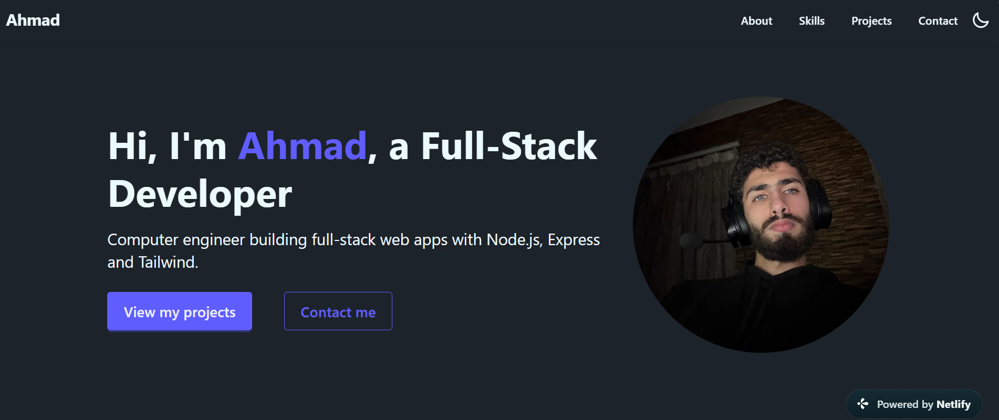

# Ahmad Sweid | Portfolio Landing Page

A responsive personal portfolio built to practice front-end fundamentals and to introduce myself to employers.

**Live site:** https://ahmad-sweid.netlify.app

## Features

- Responsive layout for mobile, tablet and desktop
- Sticky navbar with a mobile hamburger menu
- Light and dark theme switch, saved in localStorage
- Skills and projects sections
- Contact form connected to Formspree
- Lighthouse scores: Performance 97, Accessibility 94, Best Practices 96, SEO 91

## Tech used

HTML, Tailwind CSS v4, DaisyUI, JavaScript, Formspree, Netlify, Git and GitHub

## Plain CSS vs Tailwind

With plain CSS, I had to get stucked in the big dicumentation hell but with Tailwind I could build faster cleaner and in more logical interestong way"

## What I learned

With plain CSS, I had to get stucked in the big dicumentation hell but with Tailwind I could build faster cleaner and in more logical interestong way"
"The hardest part of Tailwind was to know all the needed stuff, because not all the time u need a builduped component"
"For a bigger project, I would choose TailWind and DaisyUI because of it make the coding easier and easier.
"last but not least i learned how to deploy and test this small project in netlify "https://ahmad-sweid.netlify.app/" and how to test with light house report making me polishing the project before ceploy it;

## Run it locally

    npm install
    npm run dev

Then open `public/index.html` with Live Server.
